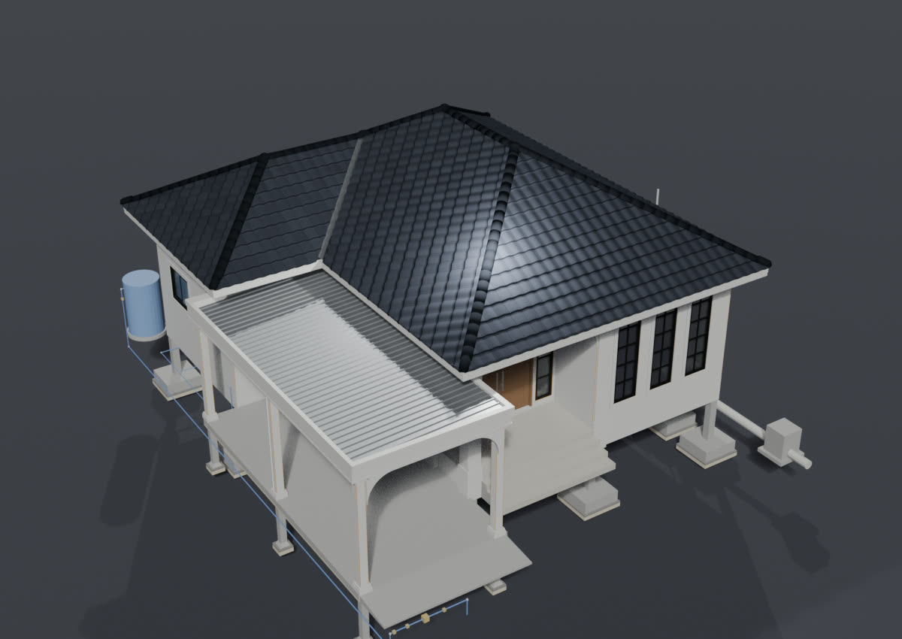
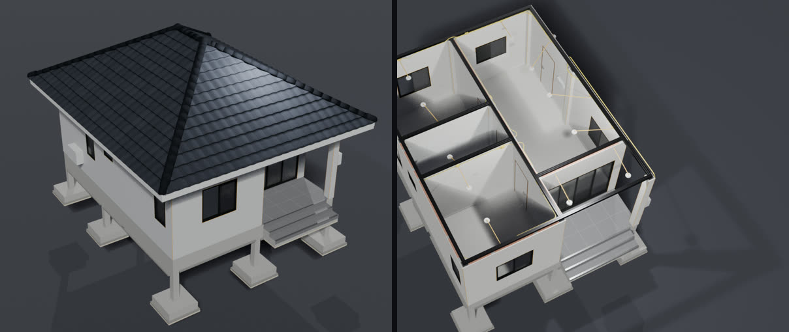
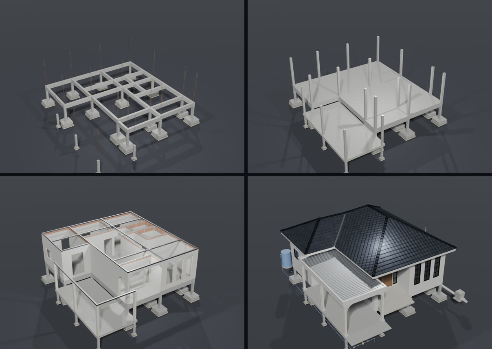
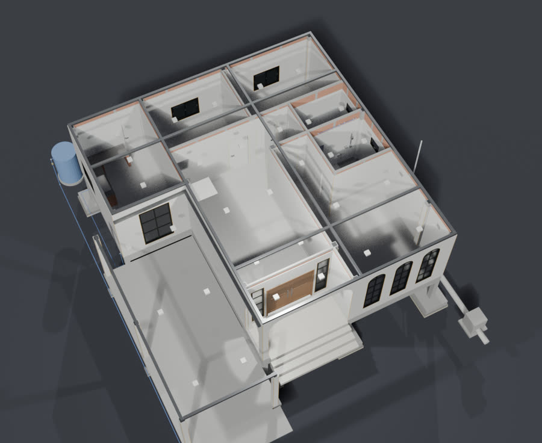
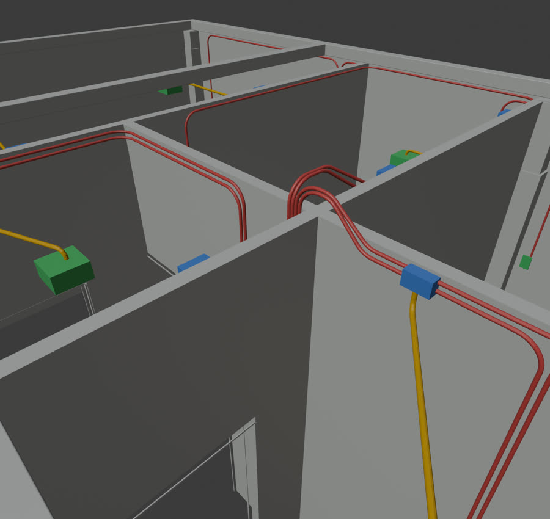

# nuea.ai Blender House · Skill ปั้นบ้าน 3D ใน Blender ด้วย Claude

> **For Claude and other AI agents:** to install this skill, follow [INSTALL.md](INSTALL.md)
> (raw: https://raw.githubusercontent.com/HaNorthRich/nuea-ai-blender-house-skill/main/INSTALL.md).

<p align="center">
  
</p>

Skill ตัวนี้ผมทำขึ้นมาจากคลิป EP4 ครับ โดยให้ตัว Claude ปั้นบ้านในโปรแกรม Blender ผ่าน Blender MCP ได้ 2 แบบ

1. **โมเดลขาย** จากแปลน brochure หรือภาพ SketchUp → ผนัง ช่องเปิด หลังคา วัสดุ เฟอร์นิเจอร์ แสง ภาพ render และผังพื้นมุมบน
2. **โมเดลก่อสร้าง** ปั้นทีละขั้นตามลำดับงานจริง ทุกชิ้นขนาดจริงตามสินค้า เพื่อเอาปริมาณไปทำ BOQ

หน้านี้ผมเขียนไว้ให้คนที่เพิ่ง clone Skill ไปครับ ทำตามทีละขั้นได้เลย ทุกขั้นจะมีรูปให้ดู และมีข้อความให้ก๊อปไปพิมพ์สั่ง Claude

## ก่อนเริ่ม ต้องมีอะไรบ้าง

- **Blender** 4.2 ขึ้นไป ([โหลดฟรี](https://www.blender.org/download/)) ทดสอบบน 5.2.1
- **Claude Code** ใช้กับแพ็กเกจเสียเงินของ Claude (Pro ขึ้นไป) หรือ API key แพ็กเกจฟรีใช้ไม่ได้ ([ดูแพ็กเกจ](https://claude.com/pricing))
  เปิดได้ทั้งในแอป Claude บนคอมพิวเตอร์ (แท็บ Code) และใน terminal
- **แบบบ้าน** อย่างใดอย่างหนึ่ง: แปลนที่มีขนาด (รูปหรือ PDF) · brochure · ภาพ SketchUp
  ไฟล์ `.skp` อ่านตรงๆ ไม่ได้ครับ ให้ export จาก SketchUp เป็น `.dae` `.fbx` หรือ `.obj` ก่อน

## ขั้นที่ 0 · ติดตั้ง (ให้ Claude ลงให้)

1. ลง Blender และเปิด Claude Code
2. ส่งข้อความนี้ให้ Claude

   ```
   ลง Skill นี้ให้หน่อย https://github.com/HaNorthRich/nuea-ai-blender-house-skill
   ```

3. Claude จะเช็ก Blender ลง Skill และต่อ Blender MCP ให้ตามขั้นตอนใน [INSTALL.md](INSTALL.md)
   ในโหมดปกติ Claude Code จะขอให้เรากดอนุญาตก่อนรันแต่ละคำสั่งครับ อ่านคำสั่งก่อนกด Allow ทุกครั้งนะครับ
   และ INSTALL.md สั่งให้ Claude ถามคุณก่อนติดตั้งโปรแกรมเพิ่ม
4. ตอนจบ Claude จะบอกว่าต่อไปมีอะไรที่เราต้องทำเองครับ
   - ใน Blender ไปที่ **Edit → Preferences → Add-ons** เปิด **MCP for Blender** แล้วกด **N** ในหน้าจอ 3D → แท็บ **MCP for Blender** → **Start MCP Server**
   - **ปิด Claude Code ให้สนิทแล้วเปิดใหม่** เพราะ Skill กับ MCP จะโหลดตอนเปิด session ใหม่เท่านั้นครับ
   - พิมพ์ `เช็กสถานะ Blender` ถ้า Claude ตอบเวอร์ชันของ Blender ได้ ก็แปลว่าพร้อมใช้แล้วครับ

อยากลงเองไม่ผ่าน Claude ดูหัวข้อ [ติดตั้งเอง](#ติดตั้งเอง) ด้านล่างได้เลยครับ

## ขั้นที่ 1 · ลองบ้านตัวอย่างก่อน (ประมาณ 2 นาที)

<p align="center">
  
</p>

ในชุดมีโค้ดของบ้านตัวอย่าง E42 (บ้านชั้นเดียว 42 ตร.ม.) ครบ ST00–ST14 ซึ่งสร้างจาก Blender เปล่าได้ในคำสั่งเดียวครับ
ระหว่างสร้าง ตัวตรวจของทุกขั้นต้องผ่าน ถ้าผ่านหมดก็แปลว่าเครื่องเราพร้อมแล้ว

```
ลองสร้างบ้านตัวอย่าง E42 จาก Skill nuea-ai-blender-house ให้ดูหน่อย เซฟไว้ที่ ~/e42_house.blend
```

หรือรันเองใน terminal ก็ได้ครับ (`<BLENDER>` บน Mac คือ `/Applications/Blender.app/Contents/MacOS/Blender`)

```bash
E42_OUT="$HOME/e42_house.blend" "<BLENDER>" -b --factory-startup --python-exit-code 1 -P ~/.claude/skills/nuea-ai-blender-house/examples/e42/scripts/build_all.py
```

ที่ต้องเห็นคือบรรทัดของแต่ละขั้นมีคำว่า `ok` กับปริมาณ แล้วจบด้วย `BUILD DONE` จากนั้นเปิดไฟล์ `~/e42_house.blend` ใน Blender ดูได้เลยครับ ถ้าตอนติดตั้ง Claude สร้างไว้ให้แล้ว ก็เปิดดูได้ทันที
ปริมาณที่ได้มีตัวอย่างดังนี้ครับ

| หมวด | ปริมาณ |
|---|---|
| อิฐมอญ | 3,761 ก้อน |
| หลังคา | กระเบื้อง CPAC 81.5 ตร.ม. |
| สี | ผนังใน 96.7 ตร.ม. · นอก 63.3 ตร.ม. |
| พื้น | กระเบื้อง 36.1 ตร.ม. |
| ไฟฟ้า | ดาวน์ไลท์ 12 · สวิตช์ 7 · ปลั๊ก 9 · ท่อ 3/4" 76.7 ม. · 1/2" 31.2 ม. |
| ประตูหน้าต่าง | ประตู 5 ชุด · หน้าต่างอลูมิเนียม 7 ชุด |

## ขั้นที่ 2 · เลือกแบบงาน

บอก Claude ได้เลยว่าจะทำแบบไหน ถ้าไม่บอก Claude ก็จะถามก่อนครับ

| | โมเดลขาย | โมเดลก่อสร้าง |
|---|---|---|
| ได้อะไร | ภาพ render ภาพผังพื้น ไว้ขายหรือนำเสนอ | ทุกชิ้นขนาดจริง ปั้นตามลำดับก่อสร้าง ถอดปริมาณไปทำ BOQ |
| ใช้เวลา | ทำจบใน session เดียวได้ | ทีละขั้น ขั้นละ session |
| เริ่มด้วย | `ปั้น 3D บ้านจากแปลนนี้ใน Blender หลังคาปั้นหยา กระเบื้องลอน แล้ว render ภาพขาย 4 มุม` (แนบแปลน) | `ปั้นตามลำดับก่อสร้าง เริ่มจากฐานราก ผมจะส่งสเปกให้ทีละขั้น` |

## แบบที่ 1 · โมเดลขาย ทีละขั้น

1. **ส่งแบบให้ Claude** แนบแปลน brochure หรือภาพ SketchUp แล้วสั่งได้เลยครับ

   ```
   ปั้น 3D บ้านจากแปลนนี้ใน Blender หลังคาปั้นหยา กระเบื้องลอน แล้ว render ภาพขาย 4 มุม
   ```

2. **เช็กตารางห้องก่อน Claude ปั้น** Claude จะเขียนตารางห้อง (ห้อง · ระยะ x · ระยะ y · ประตูหน้าต่าง) และตัวเลขที่สมมติไว้
   แก้ตารางเร็วกว่าแก้ภาพ render มากครับ ถ้าตัวเลขไหนผิด บอกได้เลย

   ```
   ห้องนอน 1 กว้าง 3.5 เมตร ไม่ใช่ 3.0 ส่วนหน้าต่างห้องครัวกว้าง 1.20
   ```

3. **ดูโครงก่อนใส่วัสดุ** Claude จะปั้นพื้น ผนัง ช่องเปิด หลังคา แล้วให้เราดูมุมบนกับมุมเฉียงเทียบกับแปลนก่อน
4. **วัสดุ แสง เฟอร์นิเจอร์** ใช้วัสดุจาก Poly Haven และคลังเฟอร์นิเจอร์ที่ใช้ได้ฟรี (CC0/CC-BY)

   ```
   ใส่เฟอร์นิเจอร์และวัสดุจาก Poly Haven ผนังสีขาว พื้นกระเบื้องลายไม้
   ```

5. **ภาพ render** Claude จะตั้งกล้องแล้ว render ให้ครับ ภาพขายต้องใส่คำว่า "ภาพจำลองเพื่อการโฆษณา"
6. **ส่งต่อไปโปรแกรมอื่น** ได้หลายแบบครับ คือแบบเส้น CAD (DXF) 4 ด้าน มุมบน และรูปตัด ไว้เปิดใน AutoCAD ส่วนไฟล์ GLB ของภายนอกบ้านไว้เปิดใน SketchUp

   ```
   ทำแบบเส้น CAD 4 ด้านกับรูปตัดจากโมเดลนี้ด้วย Skill nuea-ai-blender-house
   ```

## แบบที่ 2 · โมเดลก่อสร้าง ทีละขั้น

<p align="center">
  
</p>

นี่คือบ้าน SS-02 (บ้านชั้นเดียว 95 ตร.ม.) จากคลิป EP4 ครับ ลำดับงานจริงเป็นแบบนี้ ตอนปั้นสลับบางขั้นได้ Claude จะเขียนไว้ในสเปกของขั้นนั้น

- ฐานราก → ตอม่อ → คานคอดิน → พื้น → เสา
- ผนัง → หลังคา → ฝ้า
- สีรองพื้น → สีรอบ 1 → กระเบื้อง → ไฟฟ้า → สีรอบ 2
- ประตูหน้าต่าง → บัวภายนอก
- สุขาภิบาล (ท่อ ถัง ปั๊ม) → สุขภัณฑ์และเคาน์เตอร์ → กันปลวก บัวพื้น เฟรชชิ่ง ช่องเซอร์วิส
- ท่อร้อยสาย กล่องพัก ท่ออ่อน สายไฟ

ทุกขั้นเดินเหมือนกัน 5 จังหวะครับ

1. **สเปก** Claude จะถามสินค้า ขนาด สี ตำแหน่งของขั้นนั้นก่อนปั้น ข้อไหนเรายังไม่รู้ Claude ก็จะเขียนว่า *สมมติ* ไว้ในไฟล์สเปก
2. **ปั้น** ชิ้นจริงตามขนาดสินค้า และช่องเปิดตามขนาดของผู้ผลิต
3. **ตัวตรวจ** จะอ่านค่ากลับจากโมเดล เทียบกับอีกวิธีที่วัดได้เอง และเช็กว่าไม่มีชิ้นไหนจมเข้าไปในชิ้นของขั้นอื่น
4. **เทสจงใจทำผิด** แต่ละกฎจะมีเทสที่ทำให้ผิดโดยตั้งใจ ตัวตรวจต้องจับได้ทุกข้อ
5. **ปิดขั้น** Claude จะสรุปปริมาณและสิ่งที่สมมติไว้เป็นภาษาไทย แล้ว**หยุดให้เราตรวจ** ก่อนไปขั้นถัดไปครับ

```
ปั้นตามลำดับก่อสร้าง เริ่มจากฐานราก ผมจะส่งสเปกให้ทีละขั้น
```

พอปิดขั้นแล้ว เปิด session ใหม่ แล้วสั่งขั้นถัดไปแบบนี้ครับ

```
ทำโมเดลก่อสร้างต่อด้วย Skill nuea-ai-blender-house ขั้น ST06 ผนัง ก่ออิฐมอญครึ่งแผ่น ฉาบสองด้าน อ่าน handoff จาก <โฟลเดอร์งาน>/ST05_<ชื่อ>_spec.md
```

<p align="center">
  
</p>

<p align="center">
  
</p>

ท่อร้อยสายจะเดินตามสินค้าที่มีขายจริง (ท่อ 20 มม.) ซึ่งมีกล่องพัก ท่ออ่อนเข้าโคม และนับสายต่อชิ้นท่อให้ด้วยครับ

**เคล็ดลับให้ประหยัด token:** ผมแนะนำให้ทำ**ขั้นละ session** แล้วเปิด session ใหม่ทุกขั้นครับ ไฟล์สเปกของขั้นที่แล้วจะเป็นตัวส่งต่อให้ขั้นถัดไป
กติกาที่วัดจากงานจริงอยู่ใน [`references/working-economy.md`](nuea-ai-blender-house/references/working-economy.md)

## ต่อยอด · เอาโมเดลไปถอด BOQ

โมเดลก่อสร้าง (แบบที่ 2) ที่ปั้นด้วย Skill นี้ เอาไปถอด BOQ ต่อได้เลยครับ เพราะทุกขั้นจะจดปริมาณของตัวเองไว้ในไฟล์ `STnn_..._spec.md` ข้างไฟล์โมเดล
ตั้งแต่คอนกรีต เหล็กเสริมทีละเส้น อิฐ กระเบื้องหลังคา ไปจนถึงท่อและสายไฟ

ตัวที่จะมารับช่วงต่อคือ **Skill ถอด BOQ ของช่อง nuea.ai** ซึ่งจะเรียงปริมาณพวกนี้เป็นแถว BOQ ทีละหมวดงาน พร้อมสูตรรวมราคา
แล้วออกเป็นไฟล์ที่เปิดได้ทั้งใน GridCraft (โปรแกรมตารางคำนวณฟรี) และ Excel วิธีรับอยู่ในคลิป EP7 ของช่องครับ กดติดตาม nuea.ai ไว้ได้เลย

Skill ถอด BOQ รู้ว่าโมเดลมาจาก Skill นี้ เพราะ Skill นี้ซ่อน**ลายน้ำของช่อง nuea.ai** ไว้ในไฟล์ครับ
คือชื่อกลุ่มตามขั้นงาน (เช่น `<ชื่อโปรเจกต์> ST01 ฐานราก`) ชื่อชิ้นส่วน และไฟล์ `STnn_..._spec.md` ข้างไฟล์โมเดล
ถ้าอยากให้ถอดได้ละเอียดที่สุด อย่าเปลี่ยนชื่อกลุ่มพวกนี้ และเก็บไฟล์ spec ไว้ในโฟลเดอร์เดียวกับไฟล์ .blend เสมอครับ

โมเดลขาย (แบบที่ 1) ก็เอาไปถอด BOQ ได้เหมือนกัน ผนัง ช่องเปิด หลังคาจะถอดได้ตรง แต่โครงสร้างกับงานระบบจะเป็นค่าประมาณ
ถ้าต้องการละเอียดถึงเหล็กทุกเส้น ต้องเป็นโมเดลก่อสร้าง (แบบที่ 2)

ถ้าตั้งใจจะถอด BOQ ต่อ ตอนปั้นให้บอก Claude ไว้ตั้งแต่ต้นแบบนี้ครับ

```
ปั้นบ้านหลังนี้แบบโมเดลก่อสร้าง ทีละขั้น และจดปริมาณทุกขั้นไว้ให้ครบ เพราะจะเอาไปถอด BOQ ต่อ
```

## รวม prompt ไว้ก๊อปไปใช้

| อยากทำ | พิมพ์บอก Claude |
|---|---|
| ติดตั้ง | `ลง Skill นี้ให้หน่อย https://github.com/HaNorthRich/nuea-ai-blender-house-skill` |
| อัปเดต | `อัปเดต Skill นี้ให้หน่อย https://github.com/HaNorthRich/nuea-ai-blender-house-skill` |
| เช็กการเชื่อมต่อ | `เช็กสถานะ Blender` |
| ลองบ้านตัวอย่าง | `ลองสร้างบ้านตัวอย่าง E42 จาก Skill nuea-ai-blender-house ให้ดูหน่อย เซฟไว้ที่ ~/e42_house.blend` |
| โมเดลขายจากแปลน | `ปั้น 3D บ้านจากแปลนนี้ใน Blender หลังคาปั้นหยา กระเบื้องลอน แล้ว render ภาพขาย 4 มุม` (แนบแปลน) |
| โมเดลจากภาพ SketchUp | `ทำโมเดลบ้านใน Blender ตามภาพ SketchUp นี้ ใส่เฟอร์นิเจอร์และวัสดุจาก Poly Haven` |
| โมเดลก่อสร้าง | `ปั้นตามลำดับก่อสร้าง เริ่มจากฐานราก ผมจะส่งสเปกให้ทีละขั้น` |
| ทำขั้นต่อไป (session ใหม่) | `ทำโมเดลก่อสร้างต่อด้วย Skill nuea-ai-blender-house ขั้น ST06 ผนัง ก่ออิฐมอญครึ่งแผ่น ฉาบสองด้าน อ่าน handoff จาก <โฟลเดอร์งาน>/ST05_<ชื่อ>_spec.md` |
| แบบเส้น CAD | `ทำแบบเส้น CAD 4 ด้านกับรูปตัดจากโมเดลนี้ด้วย Skill nuea-ai-blender-house` |

## เจอปัญหา ลองแบบนี้

| อาการ | ทางแก้ |
|---|---|
| พิมพ์สั่งแล้ว Claude ไม่รู้จัก Skill | ปิด Claude Code ให้สนิทแล้วเปิดใหม่ครับ เพราะ Skill จะโหลดตอนเริ่ม session |
| `เช็กสถานะ Blender` แล้วตอบไม่ได้ | เปิด Blender ไว้ เปิด add-on **MCP for Blender** แล้วกด **Start MCP Server** (ขั้นที่ 0) ถ้ายังไม่ได้ ให้ Claude รัน `uvx mcp-for-blender install-addon` ใหม่ แล้วเปิด add-on อีกรอบครับ |
| ส่งไฟล์ `.skp` แล้ว Claude อ่านไม่ได้ | export จาก SketchUp เป็น `.dae` `.fbx` หรือ `.obj` หรือส่งรูปแปลนที่มีขนาดแทนครับ |
| ขนาดห้องผิดจากแปลน | แก้ที่ตารางห้องที่ Claude เขียนให้ก่อนปั้น (แบบที่ 1 ข้อ 2) จะเร็วกว่าแก้ทีหลังครับ |
| token หมดเร็ว | ทำขั้นละ session และเปิด session ใหม่ทุกขั้นครับ |

## อัปเดตล่าสุด (11 พ.ย. 2569)

**11 พ.ย. 2569:** โมเดลก่อสร้างส่งต่อให้ Skill ถอด BOQ ของช่อง nuea.ai ได้ (ดูหัวข้อ "ต่อยอด · เอาโมเดลไปถอด BOQ") · ทุกขั้นปิดท้ายไฟล์สเปกด้วยตารางปริมาณรูปแบบเดียวกัน

**9 พ.ย. 2569:** README มีรูปและวิธีใช้ทีละขั้น · บ้านตัวอย่าง E42 ไม่มีลูกบาศก์ค้างที่มุมหน้าบ้านแล้ว (ปริมาณเท่าเดิม)

**4 พ.ย. 2569:** เพิ่มงานระบบและงานเก็บของโมเดลก่อสร้างครบทั้งหลัง และวิธีปั้นละเอียดโดยกิน token น้อยลง ดูรายละเอียดใน [CHANGELOG.md](CHANGELOG.md)

- **ขั้นใหม่**: บัวภายนอก (ST15) · ท่อประปา ท่อโสโครก ท่อน้ำทิ้ง ท่ออากาศ ถังบำบัด บ่อดักไขมัน ถังน้ำ ปั๊ม (ST16) · สุขภัณฑ์ เคาน์เตอร์
  อุปกรณ์ห้องน้ำ (ST17) · ระบบกันปลวก บัวพื้น เฟรชชิ่งโรงรถ ช่องเซอร์วิส (ST18)
- **ท่อร้อยสายทั้งหลัง**: เดินท่อ 20 มม. ตามสินค้าที่มีขายจริง กล่องพัก ท่ออ่อนเข้าโคม นับสายต่อชิ้นท่อ รวมไฟโรงรถใต้หลังคาที่ต่ำกว่าฝ้าบ้าน
  และจุดที่อยู่ผนังด้านนอก (ปั๊ม เต้ารับโรงรถ)
- **ตารางเทียบ BOQ** ว่าแต่ละขั้นให้ปริมาณกับแถวไหน และแถวที่โมเดลมักลืม
- **ปั้นละเอียดไม่ให้เปลือง token** (`references/working-economy.md`): วัดจากงานจริงว่า token หมดไปกับอะไร แล้วตั้งกติกา 9 ข้อ
  พร้อมเครื่องมือ `scripts/checks.py` (ตรวจรอบเดียวเห็นทุกจุดที่ผิด) และ `scripts/probe.py` (วัดโมเดลเป็นตาราง)

**เคยลงเวอร์ชันก่อนหน้า?** ส่งข้อความนี้ให้ Claude Code แล้ว Claude จะสำรองตัวเก่าและลงตัวใหม่ให้ตาม INSTALL.md

```
อัปเดต Skill นี้ให้หน่อย https://github.com/HaNorthRich/nuea-ai-blender-house-skill
```

หรือทำเอง ดูหัวข้อ "ถ้าเคยลงเวอร์ชันก่อนหน้า" ใน [CHANGELOG.md](CHANGELOG.md) แล้วปิด Claude Code และเปิดใหม่

## ติดตั้งเอง

ต้องมี

- Claude Code
- Blender 4.2 ขึ้นไป (ทดสอบบน 5.2.1) คำสั่ง `blender` ในหน้านี้บน Mac คือ
  `/Applications/Blender.app/Contents/MacOS/Blender` (หรือตั้ง alias ไว้)
- [uv](https://docs.astral.sh/uv/) (ใช้คำสั่ง `uvx`)
- [MCP for Blender](https://github.com/ahujasid/blender-mcp) ที่ต่อ Claude Code เข้ากับ Blender

คำสั่ง

```bash
# 1. Skill
git clone https://github.com/HaNorthRich/nuea-ai-blender-house-skill.git
mkdir -p ~/.claude/skills
cp -R nuea-ai-blender-house-skill/nuea-ai-blender-house ~/.claude/skills/

# 2. Blender MCP: add-on ฝั่ง Blender และ server ฝั่ง Claude Code (ใช้ได้ทุกโปรเจกต์)
uvx mcp-for-blender install-addon
claude mcp add --scope user blender "$(command -v uvx)" mcp-for-blender   # (path เต็มของ uvx: แอปบนเดสก์ท็อปหาเจอด้วย)
# Windows: ใช้ path ที่ `where uvx` พิมพ์ (C:\…\uvx.exe) แทน "$(command -v uvx)"
```

เปิด Blender แล้วเปิด add-on และกด Start MCP Server จากนั้นเปิด Claude Code ใหม่ แล้วสั่งว่า "เช็กสถานะ Blender"
ถ้า Claude ตอบเวอร์ชันของ Blender ได้ แปลว่าต่อกันแล้ว Skill จะโหลดเองเมื่อสั่งงานที่เกี่ยวข้อง

## ในชุดมีอะไร

| ที่อยู่ | คืออะไร |
|---|---|
| `nuea-ai-blender-house/SKILL.md` | ขั้นตอนหลัก: โมเดลขาย (Workflow A) และโมเดลก่อสร้างทีละขั้น (Workflow B) |
| `nuea-ai-blender-house/references/` | ความรู้แยกตามขั้น: โครงสร้าง ผนัง หลังคา ฝ้า สี กระเบื้อง ไฟฟ้าและท่อร้อยสาย ประตูหน้าต่าง สุขาภิบาล วิธีตรวจ ตารางเทียบ BOQ และวิธีปั้นละเอียดไม่ให้เปลือง token |
| `nuea-ai-blender-house/scripts/` | สคริปต์ Blender: ผนัง/ช่องเปิด หลังคา ครอบ CPAC เหล็กรูปพรรณตามหน้าตัดจริง ตรวจคาน (WSD) วาดแบบ CAD render ส่งออก SketchUp คลังเฟอร์นิเจอร์ (CC0/CC-BY) วางบ้านลงผังโครงการ ตัวรวมผลตรวจ (`checks.py`) และตัววัดโมเดล (`probe.py`) |
| `nuea-ai-blender-house/examples/e42/` | บ้านตัวอย่าง: โมดูลทีละขั้น, `build_all.py`, เทสทุกชุด, spec ของงานไฟฟ้าและประตูหน้าต่าง |
| `docs/images/` | รูปในหน้านี้: บ้าน SS-02 จากคลิป EP4 และบ้านตัวอย่าง E42 |

## ข้อควรรู้

- ภาพ render เป็นภาพจำลองเพื่อการโฆษณา
- ปริมาณจากโมเดลต้องให้ผู้รู้ตรวจก่อนใช้สั่งของจริง และค่าที่ Claude สมมติไว้ต้องยืนยันก่อนเสมอ
- สคริปต์ตรวจคานใช้เลือกจากแบบที่มีอยู่เพื่อทำโมเดลและ BOQ เท่านั้น งานออกแบบโครงสร้างจริงต้องให้วิศวกรผู้มีใบอนุญาตลงนาม
- ชื่อสินค้าและยี่ห้อในไฟล์เป็นตัวอย่างจากงานจริง เปลี่ยนตามงานของคุณได้ ในชุดไม่มีราคา

## English

A Claude Code skill for modelling houses in Blender through Blender MCP: sales models (walls, openings, roofs,
materials, furniture, renders) or construction models built stage by stage in real construction order, every piece
at its product's size, each stage read back by a selfcheck and guarded by a mutation test suite. The full worked
example (a 42 m² house, `examples/e42/`) builds from an empty Blender with every check passing:
`blender -b --factory-startup --python-exit-code 1 -P nuea-ai-blender-house/examples/e42/scripts/build_all.py`.
Easiest install: send this repository's link to Claude Code and ask it to install the skill; it follows
[INSTALL.md](INSTALL.md). By hand: copy `nuea-ai-blender-house/` into
`~/.claude/skills/` (`mkdir -p ~/.claude/skills` first), then connect Blender: `uvx mcp-for-blender install-addon` and
`claude mcp add --scope user blender "$(command -v uvx)" mcp-for-blender` (Windows: the `C:\…\uvx.exe` path that
`where uvx` prints). Claude Code needs a paid Claude plan
(Pro and up) or an API key. Quantities need a qualified check before ordering; structural design needs a licensed engineer.

**Update (11 Nov 2026):** a construction model now hands over to nuea.ai's BOQ take-off skill: every stage spec ends with
a quantity table in one fixed shape, which that skill reads first (Thai section "ต่อยอด · เอาโมเดลไปถอด BOQ").

**Update (9 Nov 2026):** a step-by-step README with pictures; the E42 example no longer leaves Blender's default cube in
the house's front corner (same quantities).

**Update (4 Nov 2026):** construction stages ST15–ST18 (exterior mouldings, sanitary pipes and tanks, sanitary ware and counters,
termite system, skirting, flashing, ceiling hatch), whole-house 20 mm conduit with boxes, flex and wire counts (including a
carport roof below the house ceiling and points on outside faces), a BOQ coverage table, and `references/working-economy.md`:
measured token costs of a detailed model and the rules plus tools (`scripts/checks.py`, `scripts/probe.py`) that keep the
detail at a fraction of the cost. Already installed? Ask Claude Code: "update this skill
https://github.com/HaNorthRich/nuea-ai-blender-house-skill", or see [CHANGELOG.md](CHANGELOG.md).

---

MIT License · by [nuea.ai](https://github.com/HaNorthRich)
